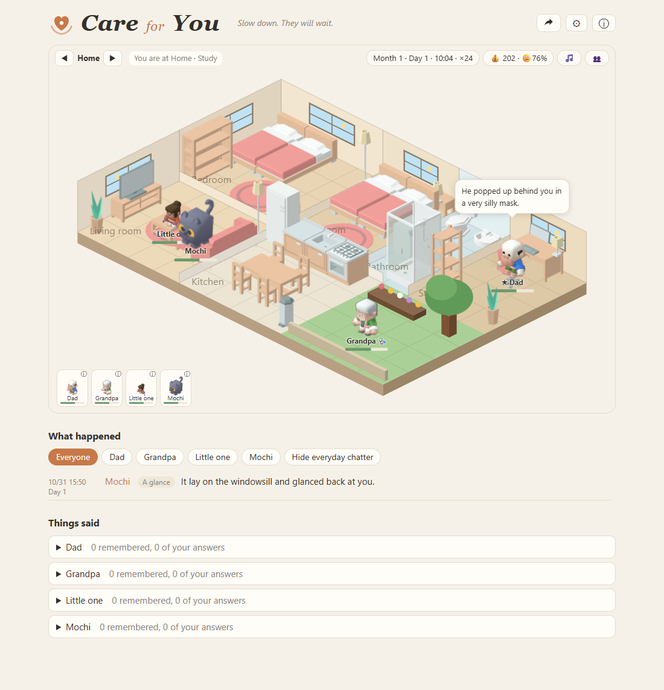

# Care for You

Pause for a moment and look after the people at home.



In work-life balance, the life is the people at home. Care for You is a quiet game in a browser tab, played beside real work, where the cost of looking after them shows up as small interruptions. There are no scores, no failing, no download and no account, and no choice is judged.

## What it is

Care for You is a small game that runs in your browser. A household of people, pets and plants lives in an isometric house. While you work, they call out to you at random: a glass of water, a word, some company, a pill to remember. You stop, look after them, and go back to what you were doing.

It is meant to sit in a tab beside your work. Nothing is urgent, nothing is punished, and nobody keeps score.

## Features

- A household you build: more than 40 kinds of people (babies to grandparents, relatives, friends), 16 kinds of animals and 6 kinds of plants, with 14 health conditions and 20 personality traits that change how they behave and talk.
- Every character is a small agent. They move between rooms on a daily routine, eat at mealtimes, sleep at night, and help each other. Needs push them off their routine.
- Care is done by pressing and holding an action. There are no countdown penalties and no failure states.
- A calm, quiet loop: questions you can answer in your own words, small events, festivals and anniversaries on an in-game calendar, and a shop where the money you earn at the desk buys beds, daily goods, decorations and gifts for visitors.
- A front door in the house: historical and literary visitors stay for a few days, you try to work out what they need, and they leave a keepsake for the cabinet. A short summary of every day goes into a calendar you can browse. See [docs/visitors.md](docs/visitors.md).
- Eight interface languages, with dialogue in each: English, 简体中文, 繁體中文, Français, 日本語, 한국어, Español, Deutsch.
- Characters, rules and lines are plain files you can open and edit, and so are the saves.

## How to play

- Click a person to see what they want, then press and hold an action until the ring fills.
- A day runs from the afternoon to midnight and takes about five minutes. At midnight you get a short summary, and the calendar button keeps every day. Settings and sharing are at the top right of the page.
- The people button opens the household: add, edit, archive or remove characters.
- You play one adult in the household, and you can switch to anyone grown-up from the people menu. Couples earn money at the desk during work hours, or you do if there is no couple.

## Run it

Open `frontend/index.html` in a browser. There is no build step and no server to start. Desktop Chrome or Edge is recommended, because choosing a data folder needs the File System Access API.

URL options for trying it out:

- `?onboard=0` skips the first-run screen.
- `?freq=test` makes interruptions very frequent. It is not saved.
- `?lang=en` forces a language.

Python 3 is only needed if you want to run one of the optional backends below.

## Data and privacy

Everything is stored on your own device as plain files. No account is needed, and there are no analytics and no cookies. By default the page sends your game data nowhere. An optional account and encrypted cloud save exist only when a server address is set in the advanced settings; see [account_server](account_server/README_account_server.md). Data leaves the device only if you turn on a remote backend or the AI connection yourself in the advanced settings. Downloading and importing saves is switched off in this version while the save format settles; saves stay on your device and can be deleted from the settings.

## Status

Early version, currently 0.73. Expect rough edges, especially on phone-sized screens. Feedback and bug reports are welcome as [issues](https://github.com/shenfan19/care-for-you/issues).

## Not a health product

This is a game. It is not a medical, psychological or care product and gives no diagnosis, treatment or medication advice. Conditions in the game are simple scenarios, not medical judgments. If you are having a hard time, please reach out to someone you trust or to a local professional service.

## For developers

The game does not hard-code who speaks or what happens. The front end sends a snapshot of each character to a backend and carries out what comes back, so the front end can be driven by another backend, including one that uses AI. The backend interface is in [README_backend_protocol.md](README_backend_protocol.md).

### Documentation

Mechanics that matter to players and people writing backends are described in `docs`. How the parts fit together and how data flows: [docs/architecture.md](docs/architecture.md). Outings: [docs/outings.md](docs/outings.md). Actions for yourself and for others: [docs/actions.md](docs/actions.md). State bars, work efficiency and money: [docs/state_and_income.md](docs/state_and_income.md). The front door and visitor cards: [docs/visitors.md](docs/visitors.md). The optional account server: [account_server/README_account_server.md](account_server/README_account_server.md). The backend interface: [README_backend_protocol.md](README_backend_protocol.md).

### Data-driven by design

The game does not hard-code who speaks or what happens. It sends a snapshot of each character's state to a backend and carries out the instructions that come back. Three ways of driving it are planned:

1. Probability tables. Done, and the default. The built-in backend runs in the browser and reads plain YAML rules.
2. Numerical integration. Experimental. Set the backend to `lm` in the advanced settings and needs, mood and frailty are integrated step by step by differential-equation models that run in the browser; the models are YAML files in the data folder (`templates/lm`, sources in `frontend/src/data/lm`). Events and lines still come from the tables. The numbers are not validated.
3. AI connection. Unfinished and off by default. It lets an external AI service rewrite lines. Turning it on sends a small amount of context to the service you choose.

All backends use the same JSON interface, described in [README_backend_protocol.md](README_backend_protocol.md). `backend_basic` is a minimal example you can replace with your own model. A remote backend that fails falls back to the built-in one.

### Characters and visitors

Every character type and every visitor is one plain YAML file. Identifiers such as `id`, `species`, `voice` and `pronoun` (`he`, `she`, `it`) are English codes, and every name or line of text is an object with one entry per interface language: `frontend/src/data/cards` for the household types and `frontend/src/data/visitors` for the visitors. Edit or add a file, then run `node tools/build_cards.js` to pack them into the scripts the page loads. The page has no build step of its own and still opens straight from `index.html`.

### Tests

```
cd frontend
node tests/logic_test.js
node tests/sim_eval.js 3 120 family
cd ..
python frontend/tests/backend_compare.py 1 3
```

`logic_test.js` covers loading, characters, rules, time, dialogue, saves and language completeness. `sim_eval.js` runs a household for a few virtual days with a simple attention strategy and checks invariants. The interface itself has no automated tests yet.

### Project layout

- `frontend`: the game. `src/core` is the game itself, `src/world` the rooms and drawing, `src/backend` the protocol and built-in backend, `src/data` the starting data and the card sources, `src/ui` the interface, `locales` the language packs, `tests` the tests.
- `backend_basic`: a minimal remote backend.
- `media`: screenshots and action previews.
- `android`: reserved, on hold.

## License and credits

Code is released under the [MIT License](LICENSE). Copyright (c) 2026 Fan Shen.

| What | Source | License | Use |
| --- | --- | --- | --- |
| Furniture art | [Kenney, Furniture Kit](https://kenney.nl/assets/furniture-kit) | CC0 1.0 | The 3D models are rendered into isometric images by `tools/render_iso`. The license text is kept in `frontend/assets/iso`. |
| Characters | [Kenney, Mini Characters 1](https://kenney.nl) | CC0 1.0 | Rendered the same way in four directions and four poses. Skin tones are recolored in the game with an SVG filter and a mask. |
| YAML parsing | [js-yaml](https://github.com/nodeca/js-yaml) | MIT | Shipped in `frontend/vendor`. |
| Rendering tool | [three.js](https://threejs.org) | MIT | Used only by the rendering tool, not shipped with the game. |
| Street backdrop | [Kenney, City Kit Commercial](https://kenney.nl) | CC0 1.0 | Small buildings behind the street. |
| Food items | [Kenney, Food Kit](https://kenney.nl/assets/food-kit) | CC0 1.0 | Food on the kitchen table and in the shop, rendered the same way. |
| Shopping props | [Kenney, Mini Market](https://kenney.nl/assets/mini-market) | CC0 1.0 | Shopping cart and market props, rendered the same way. |
| Vehicles | [Kenney, Car Kit](https://kenney.nl/assets/car-kit) | CC0 1.0 | Street scene cars, rendered the same way. |
| Animals | [Kenney, Cube Pets](https://kenney.nl/assets/cube-pets) | CC0 1.0 | Rendered the same way. Species without an exact match use the closest-looking model. |
| Plants | Kenney, Furniture Kit | CC0 1.0 | Plant models enlarged. |
| Animations, text | This project | MIT | Original. |
| Visitor cards | This project | MIT | The official visitor cards and their texts, with sources listed on each card. |

CC0 does not require attribution, and the sources are listed anyway. AI-assisted tools were used during development.
