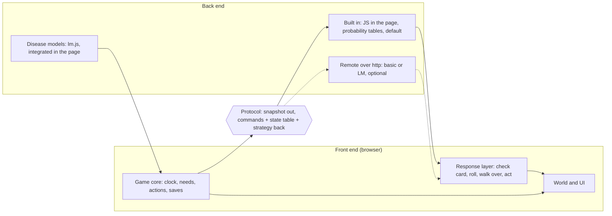
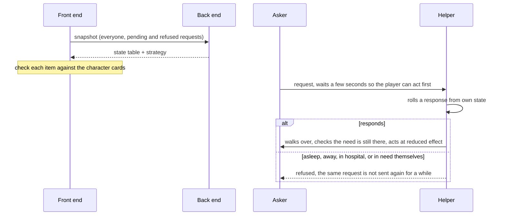
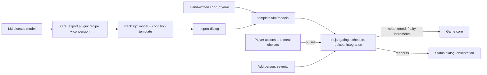

# Architecture: layers, data flow and files

This page shows how Care for You is put together: which part decides what, how one request travels, where the plain files live, and how a disease model gets from Life Matters into the game. The field-by-field description of the backend interface is in [README_backend_protocol.md](../README_backend_protocol.md). Mechanics that players see are in the other pages of this folder.

## 1. Two layers and one protocol

The game is a set of static files. Opening `frontend/index.html` is enough to play: no build step, no server, nothing leaves the machine. Inside, the work is split in two.

| Layer | Does | Does not do |
| --- | --- | --- |
| Front end | The house and the interface, the clock, saves, the player's actions, carrying out what the back end sends, deciding for each character whether to respond | Decide who asks whom, who wants to go where, what happens |
| Back end | Produces the state table (needs, mood, frailty, wishes to go out), the strategy (who sends which request to whom), the events and the lines | Walking, drawing, whether something can be carried out |
| Protocol | A snapshot goes out; commands, a state table and a strategy come back. All plain JSON, checked item by item by the front end, anything that breaks the rules is dropped | |

- Built in: ships with the game and runs in the browser. Only probability tables, no AI, no heavy back end. This is the default.
- Remote: set `backend_provider` to `http` in the advanced settings and the same protocol goes to your own process. The game first sends a hello. The reply says which of events, strategies and lines the back end handles, and which variables it integrates itself. Everything it does not claim stays with the built-in back end. If the remote fails, the game falls back to the built-in one and says so once. Two back ends are in the repository: `backend_basic` and `backend_lm_ai`.
- Disease models: a small LM-format integrator inside the page, see section 5. It is not a process and works together with the other two.

## 2. One request, step by step

Characters ask each other for help. This is the same line for needs and for wishes such as a walk.

1. Ask: every 20 seconds the front end sends a snapshot and asks for a state table and strategy.
2. Send: each character whose need is above the threshold sends requests at a per-hour probability. The receiver is drawn by weight from the others, or from themselves.
3. Check: the front end checks the character card again. Babies cannot act, so they never receive a request meant for themselves.
4. Wait: a few seconds, so the player can look after the person first.
5. Respond: the receiver rolls from the current state. Sleeping, away, in hospital or in need themselves means no response, and a refusal is remembered.
6. Act: walk over, check again, act, and write one line into the event feed.

A wish to go out takes the same route. The request is not a need but an outing, and a response sends the owner and the companion out through the normal outing flow.

The numbers (thresholds, probabilities, weights, intervals) are in `templates/system.yaml` in the data folder. They are placeholders to be tuned, and setting `agents.request.scale` to 0 removes all requests between characters.

## 3. Plain files

Everything that decides behaviour is a readable file in the data folder. Saves are plain files too.

| File or folder | Who edits | Holds |
| --- | --- | --- |
| `settings.ini` | The player | Language, theme, time, privacy; backend and account settings under advanced |
| `templates/system.yaml` | Anyone tuning the game | Request and response probabilities, wishes, weights, polling interval |
| `templates/species` | Anyone | Need rates per kind and life stage |
| `templates/events/rules.yaml` | Anyone | Event rules: per-hour probability, outcome weights |
| `templates/cards` | Anyone | One character card per kind of person, animal or plant |
| `templates/content` | Anyone | Lines, by card, condition and voice |
| `templates/conditions` | Anyone | Health conditions: needs, actions, first lines |
| `templates/lm/models` | Anyone, or the LM plugin | Disease models in LM format |

A template file carries a version. If the version inside the game is newer than the file, the file is replaced and the old one is kept in the backup folder.

## 4. Code layout

| Folder | Layer | Holds |
| --- | --- | --- |
| `frontend/src/core` | Front end | Game core, clock and time, response layer (`agents.js`), household and outings, commands (`directives.js`), settings, saves, archive import and export |
| `frontend/src/backend` | Protocol and back end | Protocol and checks (`protocol.js`), routing and handshake (`index.js`), built-in events and strategy (`local.js`, `local_plan.js`), remote transport (`http.js`, `api.js`), disease model engine (`lm.js`) |
| `frontend/src/world` | Front end | Places, the isometric house, scenes, avatars |
| `frontend/src/ui` | Front end | Interface |
| `frontend/src/data`, `frontend/locales` | Data | Seed data and rules, eight languages |
| `frontend/lab.html` | Tool | A page that edits a disease model and shows its curves, no server needed |
| `backend_basic`, `backend_lm_ai` | Back end | The two optional remote back ends |

Scripts are loaded with plain script tags in order, not as ES modules, because browsers block modules when a page is opened from a local file.

## 5. Disease models: from Life Matters to the game

A condition can carry a model: a small LM-format YAML file, integrated in the browser, so that the person's numbers follow from what the carers do and what the day looks like. The player's care actions and meal choices become inputs of the model. Readings come back as an observation panel, and some are visible only after the player has measured them. No penalty comes from not looking.

- Same format: the game reads the LM model format, so an LM model runs almost as it is. What cannot be carried over is an error in the plugin, never a silent change.
- Real time and game time differ: slow processes can be sped up with a per-equation `step_scale`, fast ones such as a meal's glucose stay real.
- Verification: the LM engine, the plugin's reference evaluator and the game's engine are compared on the same converted models. The results are in the plugin's documentation.
- The model file format is in the Disease models section of [README_backend_protocol.md](../README_backend_protocol.md). The plugin and its recipes are in `plugins/care_export` of the Life Matters Reference Engine.

## 6. Where to read next

| Question | Open |
| --- | --- |
| What a player can do for others and for themselves | [actions.md](actions.md) |
| Outings | [outings.md](outings.md) |
| State bars, work efficiency, money | [state_and_income.md](state_and_income.md) |
| Fields of the backend interface, writing your own back end | [README_backend_protocol.md](../README_backend_protocol.md) |
